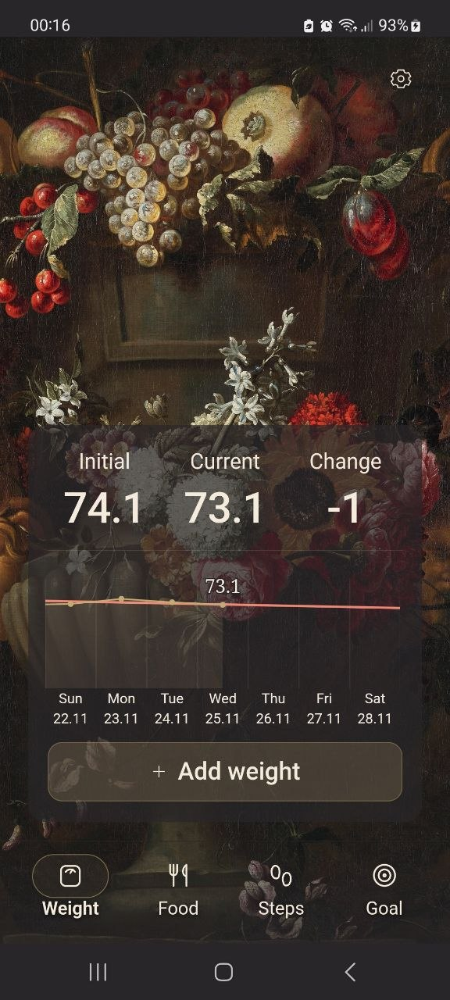
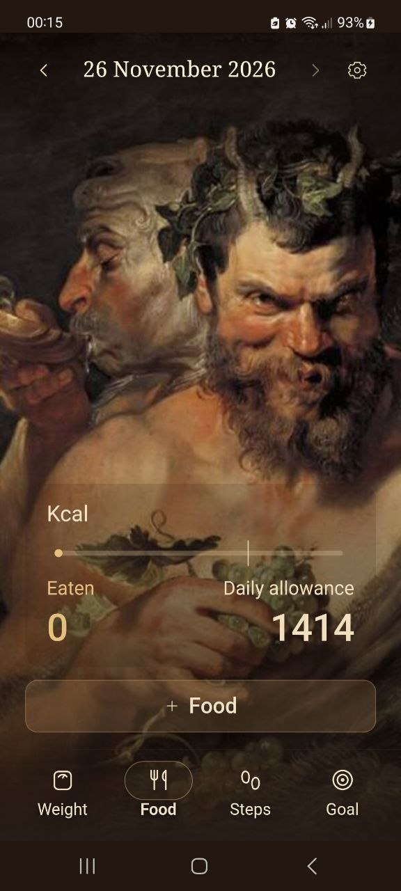
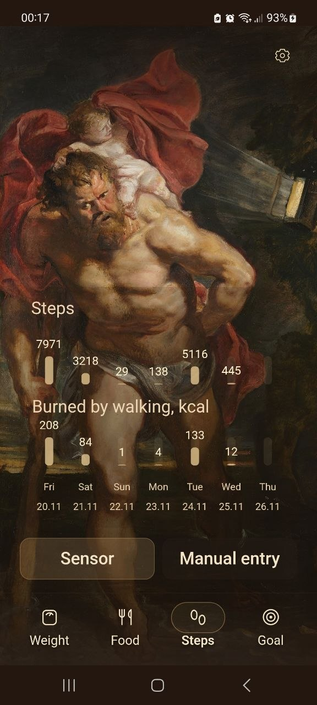
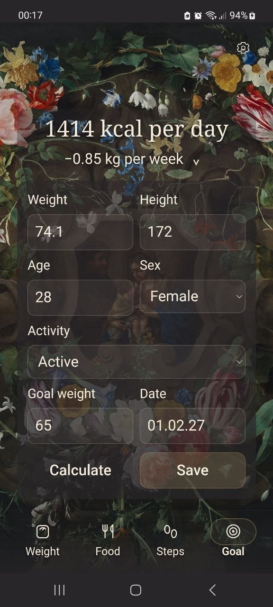

# Be Fit

Be Fit helps you track weight changes, log meals, and keep a record of your daily walking. Flemish paintings from the Alte Pinakothek, München create the backgrounds, while translucent panels keep the artwork visible. Each theme can be adjusted to suit your preferences.

## Features

- **Weight.** Log measurements, view your history, and follow a line toward your goal weight.
- **Food.** Keep a meal diary and track calories consumed and your remaining daily allowance.
- **AI input.** Describe a meal using voice input in your keyboard, type it, or attach a photo to estimate calories and ingredients through a connected ChatGPT account. Review and edit the result before saving.
- **Steps.** Count steps using your phone’s sensor, pause and resume tracking, enter steps manually, calculate calories burned by walking, and view your daily history.
- **Goal.** Set a target weight and date, calculate calorie allowance per day, plan weight change per week, and see your actual average weekly change.
- **Backup.** Export your diary to a file and restore it later.

## Four Art Themes

| Theme | Character | Artist
| --- | --- |
| Baroque | Deep, warm colours and expressive figures | Peter Paul Rubens
| Floral Atlas | Flowers, still lifes, and soft natural colours | Jacob Melchior van Herck, Franz de Hamilton, Frans Snyders, Daniel Seghers
| Northern Light | A light palette with blue and sandy tones | Pieter Brueghel d. Ä, Jan Brueghel d. Ä, Paul de Vos
| Flemish Everyday Life | Everyday scenes with a warm, intimate atmosphere | Adraen Brouwer, Frans Snyders, David Teniers d. J.

Each of the four app screens has its own painting of a particular theme. In settings, adjust the background’s position and zoom to choose the framing you prefer. Translucent panels let the artwork remain part of the experience.

## Languages

Russian · English · German · French · Italian · Spanish

## Screenshots and Demo

  
  
  
  

For the demo video, upload an MP4 in the GitHub editor and place the resulting link on its own line outside this comment.
-->

## Data and AI Connection

Your diary is stored on your phone. Logging weight, meals, and steps does not require an AI connection; the core diary works offline.

AI input is optional, connects through your own ChatGPT account, requires an internet connection, and spends your Work/Codex limits. Meal descriptions and attached photos are sent to the connected service when you press Send. A meal is added to your diary only when you save it.

## Artwork and Credits

The app uses digital reproductions from the [Bayerische Staatsgemäldesammlungen](https://www.sammlung.pinakothek.de/) collection. The in-app artwork credits include artists, titles, dates, links to individual works, and licence information.

## About the Project

Be Fit is an independent project for Android 8.0 and later, currently under active development.

This repository is a public showcase for the app, with its description, screenshots, and demo video. The source code remains private.
